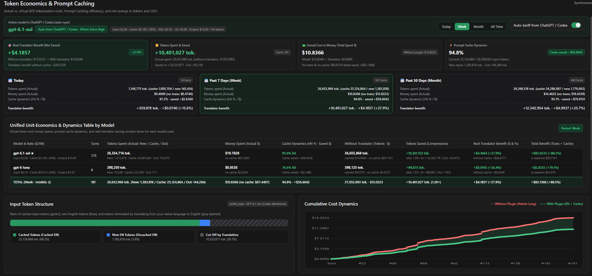
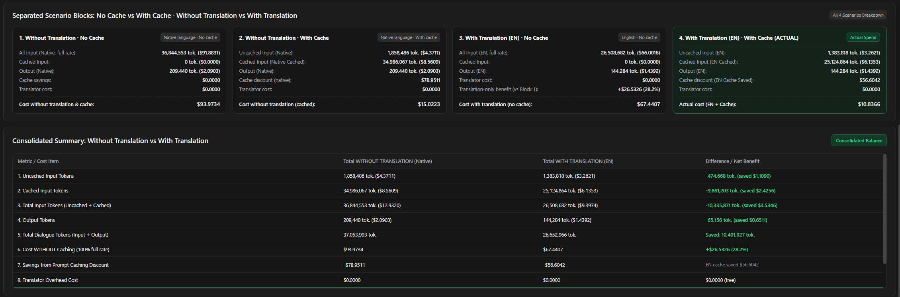
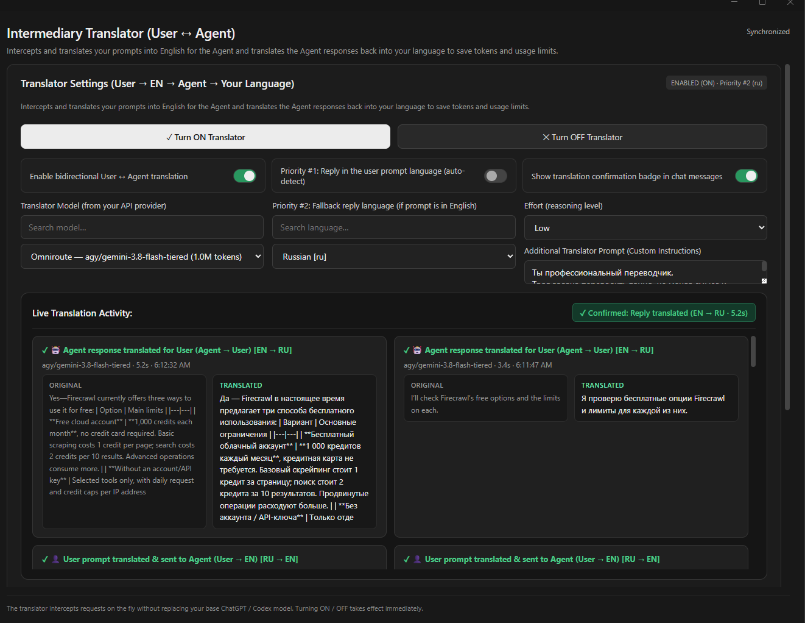
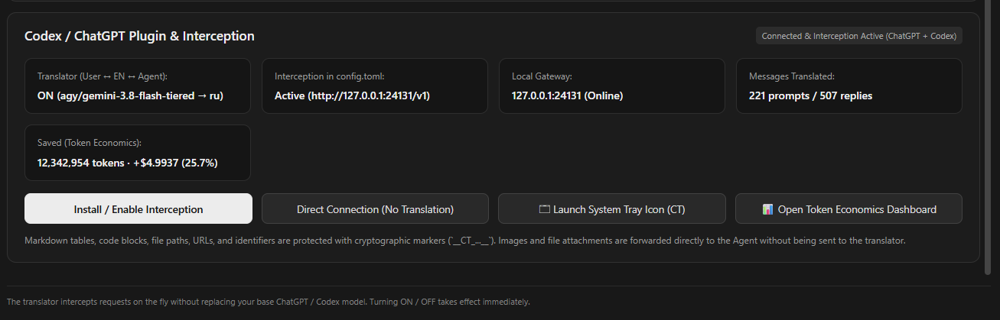
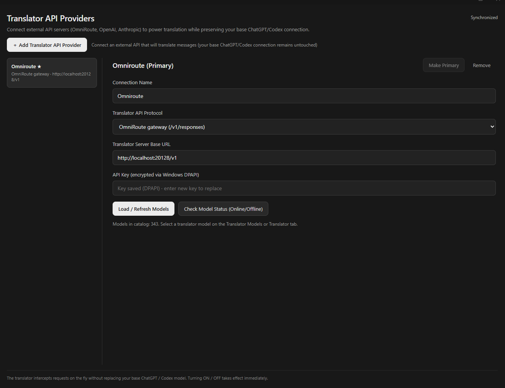
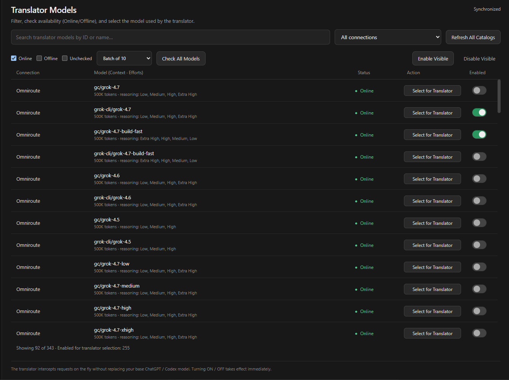
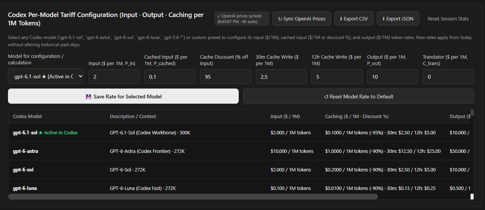
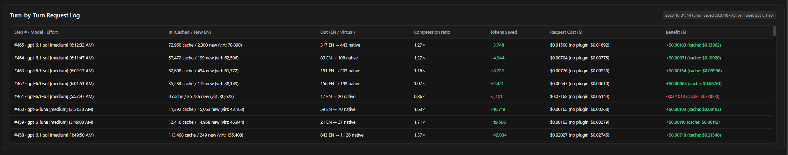

<div align="center">

# ⇄ Codex Translate Plugin

### Bidirectional Native Language <-> English Gateway & Token Economics Suite for OpenAI ChatGPT / Codex

[](package.json)
[](#quick-installation)
[](https://nodejs.org/)
[](VALIDATION.md)
[](#interface--core-functions)
[](#license)

**Write prompts in your native language while your Coding Agent reasons in pure English. Cut BPE token consumption by 1.4x to 2.5x, keep a 95% Prompt Cache hit rate, and track every saved token and dollar in real time.**

[How It Works](#how-it-works) · [Real-World Savings](#real-world-token--cost-savings) · [Interface & Functions](#interface--core-functions) · [Quick Installation](#quick-installation) · [Security & Privacy](#security--privacy) · [Full Guide (EN / RU / ZH)](INSTALLATION.md)

</div>

---

## How It Works

Non-Latin scripts (such as Cyrillic, Chinese, Japanese, Korean, Arabic, or Hindi) consume **1.4x to 2.5x more BPE tokens** than equivalent English text. In multi-turn coding sessions where the full conversation history is sent on every step, non-English dialogue quickly drains token budgets and usage limits.

**Codex Translate** runs a local loopback gateway (`http://127.0.0.1:24131/v1`) between you and the official **OpenAI ChatGPT / Codex Desktop** app or **Codex CLI** without replacing your base model, OpenAI subscription, or `auth.json` credentials:

1. **User -> Translator -> Agent:** When you send a message in your native language, the gateway locks code blocks, inline code, file paths, URLs, Markdown tables, and identifiers inside cryptographic placeholders (`__CT_<hex>_<id>__`). The natural-language text is translated into English via your external translator API and forwarded to your active Codex model (`gpt-6.1-sol`, `gpt-6-astra`, `gpt-6-luna`, `gpt-5.6-*`, `o3`, etc.).
2. **Pure English Context & Prompt Caching:** On subsequent turns, prior assistant messages are automatically restored to their original English text so the Agent always sees a 100% English history and achieves maximum Prompt Cache hit rates (`90%` to `95%`).
3. **Agent -> Translator -> User:** The Agent's English replies (including interactive `request_user_input` questions and options) are intercepted, translated back into your language with all code and paths restored verbatim, and logged in the Token Economics engine.

---

## Real-World Token & Cost Savings

The built-in **Token Economics & Prompt Caching** engine (`TokenEconomicsEngine`) uses offline BPE tokenization (`o200k_base`, `o200k_harmony`, `cl100k_base`) to measure exact token compression and cost differences across **Today**, **Week (7d)**, **Month (30d)**, and **All Time**:

- **181 Turns (1 Week on `gpt-6.1-sol` + `gpt-6-luna`):**
  - **+10,401,027 BPE tokens saved** (`26.65M` actual English tokens vs. `37.05M` virtual native tokens, `1.39x` dialogue compression).
  - **+$4.19 (+27.9%) net translator savings** even with 95% prompt caching active (`$10.84` actual spend vs. `$15.02` without the plugin).
  - **+$26.53 (+28.2%) pure translation savings** when measured without cache (`$67.44` vs. `$93.97` raw native baseline).
  - **94.8% Prompt Cache hit rate (`+$56.60` saved by caching)**, resulting in **+$83.14 (+88.5%) total combined benefit** (`$10.84` actual spend vs. `$93.97` uncached native baseline).
- **465 Turns (30 Days):** **+12,342,954 tokens saved** and **+$4.99 (+25.7%)** net cost reduction on cached turns.



### 4-Scenario Comparison & Consolidated Balance

The dashboard separates and reconciles all four billing scenarios side by side:
1. **Without Translation · No Cache:** 100% uncached native-language baseline (`$93.97`).
2. **Without Translation · With Cache:** Native-language cost with Prompt Caching discount (`$15.02`).
3. **With Translation (EN) · No Cache:** Pure BPE compression benefit from English translation (`$67.44`, saving `+$26.53`).
4. **With Translation (EN) · With Cache (Actual):** Your real-world spend combining English compression and Prompt Caching (`$10.84`).



---

## Interface & Core Functions

The Control Panel supports instant switching between **English**, **Русский**, and **中文** in the top-left sidebar.

### 1. Translator Control & Live Activity Tracker
- Turn translation **ON / OFF** with one click (takes effect immediately without restarting Codex).
- Configure **Priority #1 (Auto-detect user prompt language across 35+ languages)**, **Priority #2 (Fallback reply language)**, **Translator Model**, **Reasoning Effort**, and **Custom Terminology Instructions**.
- Inspect real-time translation pairs (`User -> EN` and `Agent -> User`) with latency and model telemetry.



### 2. ChatGPT / Codex Interception Bridge
- View live routing status (`config.toml` bridge, local gateway port `127.0.0.1:24131`, translated prompt/reply counters, and cumulative token savings).
- Enable interception, switch to a direct connection, launch the Windows **`CT`** system tray icon, or jump to the Token Economics dashboard.



### 3. External Translator API Providers
- Connect any external provider (`OpenAI Responses API`, `OpenAI Chat Completions`, `Anthropic Messages`, or `OmniRoute Gateway`) to translate messages while keeping your primary ChatGPT / Codex account untouched.
- API keys are encrypted locally on disk (via **Windows DPAPI** on Windows and authenticated **AES-256-GCM** with `0600` permissions on macOS and Linux).



### 4. Translator Models Catalog & Batch Health Check
- Search and filter discovered models by connection and availability (`Online`, `Offline`, `Unchecked`).
- Run parallel health checks in batches of 10 or 20, toggle model visibility, and select the active translator model.



### 5. Per-Model Tariff Configuration & Live OpenAI Price Sync
- Automatically syncs official model tariffs from `https://developers.openai.com/api/docs/pricing` on startup and every 4 hours (including `30m / 12h` cache write rates and `>272K` long-context tiers).
- Customize `Input`, `Cached Input` (or `Discount %`), `30m / 12h Cache Write`, `Output`, and `Translator` rates per 1M tokens for any model. New rates apply from today forward while preserving historical past days.



### 6. Turn-by-Turn Request Log & Export
- Inspect every intercepted step with model name, reasoning effort, cached vs. new input tokens, English vs. virtual native output tokens, compression ratio, tokens saved, and net dollar benefit.
- Export full analytics to **CSV** or **JSON** with one click.



---

## Quick Installation

### Prerequisites
- **OS:** Windows 10/11, macOS 12+ (Intel & Apple Silicon), or Linux (x64 / ARM64 / WSL2)
- **Runtime:** Node.js 22+ (`node --version`)
- **Client:** OpenAI ChatGPT / Codex Desktop or Codex CLI

### Step 1: Clone the Repository

```bash
git clone https://github.com/Daariec/Codex-translate-by-Arlen.git codex-translate
cd codex-translate
```

### Step 2: Run the Installer for Your OS

| Operating System | Installer File in Folder | Action |
| :--- | :--- | :--- |
| **Windows** | **`Install-Plugin for Windows.cmd`** *(or `Install-Plugin.cmd`)* | Double-click **`Install-Plugin for Windows.cmd`** in File Explorer, or run `.\"Install-Plugin for Windows.cmd"` in PowerShell. |
| **macOS** | **`Install-Plugin for MacOS.command`** *(or `Install-Plugin for MacOS.sh`)* | Double-click **`Install-Plugin for MacOS.command`** in Finder, or run `chmod +x *.sh *.command && ./"Install-Plugin for MacOS.sh"` in Terminal. |
| **Linux** | **`Install-Plugin for Linux.sh`** *(or `install-plugin.sh`)* | Run `chmod +x *.sh && ./"Install-Plugin for Linux.sh"` in Terminal. |

The installer automatically installs `gpt-tokenizer` if needed, registers and enables the plugin in `~/.codex/config.toml`, backs up your original configuration, sets `openai_base_url = "http://127.0.0.1:24131/v1"`, starts the background gateway (`127.0.0.1:24131`), and (on Windows) starts the **`CT`** system tray icon.

### Step 3: Add a Translator Provider & Turn ON
1. Open the Control Panel (`CodexTranslate.exe` or `.\Panel.cmd` on Windows; `./panel.sh` or `node cli.mjs panel` on macOS/Linux).
2. Open **API Providers -> + Add Translator API Provider**, enter your translator server URL and API key, and click **Load / Refresh Models**.
3. Open **Translator (ON/OFF)**, select your translator model and fallback reply language, click **Test Translation**, and click **Turn ON Translator**.
4. Restart ChatGPT / Codex once so it connects through `127.0.0.1:24131`. Subsequent **ON / OFF** toggles work instantaneously.

---

## CLI & Launcher Reference

```bash
# Toggle translator state via CLI (Windows, macOS, Linux):
node cli.mjs on
node cli.mjs off
node cli.mjs toggle

# Check status, active model, and routing:
node cli.mjs status

# Open Control Panel or Quick Switcher:
# Windows:
.\CodexTranslate.exe          # Full Control Panel (or .\Panel.cmd)
.\CodexTranslate.exe --switch # Native Quick Switcher (or .\Switch.cmd)
.\CodexTranslate.exe --tray   # System Tray Icon CT (or .\Tray.cmd)
# macOS / Linux:
./panel.sh                    # Full Web Control Panel
./switch.sh                   # Interactive Terminal Quick Switcher
./setup.sh                    # Interactive CLI Provider Manager

# Restore direct connection in ~/.codex/config.toml:
node cli.mjs restore

# Run automated verification (43 tests):
npm test
```

For detailed multilingual setup, updates, and troubleshooting instructions, see **[INSTALLATION.md](INSTALLATION.md)**, **[SETUP.md](SETUP.md)**, and **[VALIDATION.md](VALIDATION.md)**.

---

## Security & Privacy

- **100% Local Loopback Execution:** The gateway runs strictly on `127.0.0.1:24131` on your machine. Prompts and responses are sent directly between your computer, your configured translator API endpoint, and the official OpenAI / ChatGPT servers without any intermediate third-party servers.
- **OS-Scoped API Key Encryption:** Translator API keys are encrypted locally on disk via **Windows DPAPI** (`Credential.ps1`) on Windows and authenticated **AES-256-GCM** (`0600` file permissions) on macOS and Linux.
- **Kept Outside the Repository:** All credentials (`credentials/*.dpapi`), provider settings (`state.json`), and token economics logs (`token-economics.json`) are stored in your OS user profile directory (`%LOCALAPPDATA%` on Windows, `~/Library/Application Support` on macOS, `~/.local/share` on Linux) and are excluded via `.gitignore`.
- **Transparent Native Launcher:** `CodexTranslate.exe` is a 10 KB Windows launcher compiled directly from the included open-source [Launcher.cs](Launcher.cs) file.

---

## License

Released under the **MIT License**.
